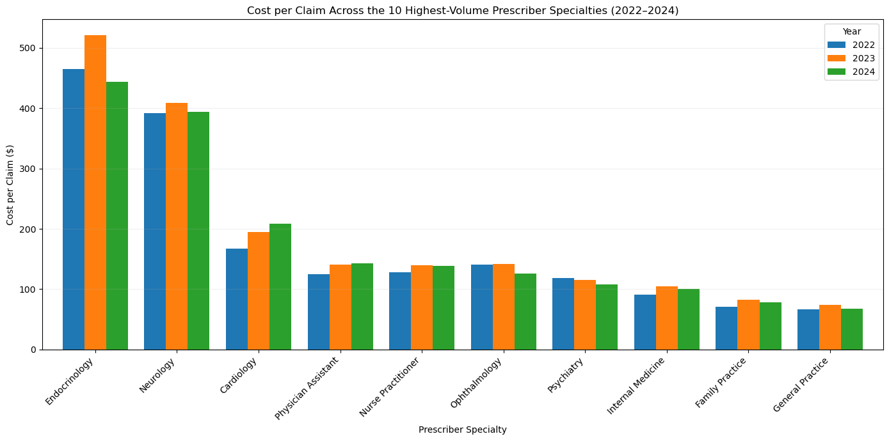
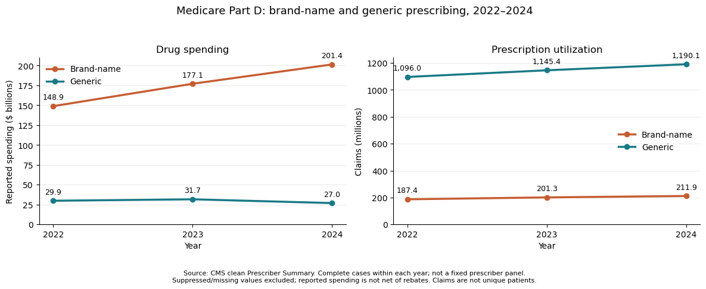

# Medicare Part D: Paying More for Similar Drugs

**Healthcare economics | Big data analytics | PySpark | Google Cloud Storage**

## Research question

**Why it matters:** Prescription spending can strain Medicare budgets and patient affordability; aggregate spending alone can obscure differences in treatment mix and prescribing patterns.

**Business question:** Where do prescription costs and utilization differ by specialty, drug type, prescriber and geography, and which patterns warrant further investigation for affordability or cost management?

## Data and methodology

Academic team project integrating CMS Part D provider/drug, provider summary and spending data for 2022–2024 with HUD ZIP-to-county and HRSA shortage-area data. PySpark standardized and joined the five sources into **80,688,291 rows × 36 columns**, with 99.94% county matching. Suppressed and unmatched values were retained as null; drug-year aggregates were not summed across provider rows. The master dataset was saved to Google Cloud Storage.

## Key findings

- Among the ten highest-volume specialties, endocrinology reached $521.24 per claim in 2023 and $443.42 in 2024; cardiology increased 24.8% from 2022 to 2024.
- Family and general practice remained below $85 per claim.
- In the observed 2024 brand/generic cohort, brand drugs accounted for 88.19% of spending but only 15.11% of claims.

Other analyses found declining median costs per 30-day fill across six high-volume drugs, small overall rural–urban opioid rate differences (4.01% urban versus 3.91% rural in 2024), and specialty-specific relationships between dual eligibility and generic prescribing.

## Business implications and limitations

Specialty and drug-level comparisons can help prioritize cost reviews, but higher costs do not establish inefficiency. Brand/generic findings cover prescriber records with complete measures (about 53–55% annually), not national totals. Drug names do not control for formulation or strength; HRSA designations are from a current rather than historical snapshot.

## Explore the analysis

[Project notebook](QST6-Paying-More-for-Similar-Drugs.ipynb) · [CMS Part D data](https://data.cms.gov/provider-summary-by-type-of-service/medicare-part-d-prescribers/medicare-part-d-prescribers-by-provider).
